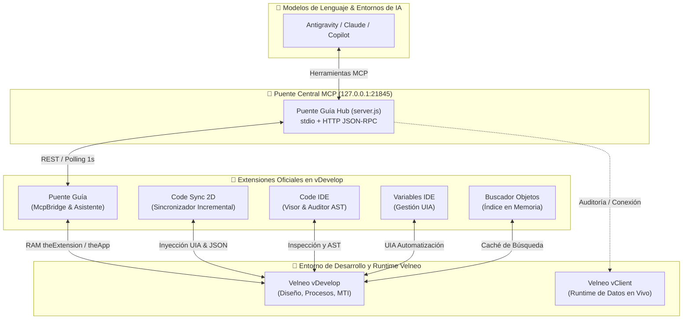

# Rubicon Velneo Extensions 🚀

> Suite corporativa de extensiones oficiales, herramientas de desarrollo asistido por IA y automatización para el ecosistema **Velneo vDevelop** y **vClient Runtime**.  
> Diseñado, desarrollado y mantenido por el equipo de ingeniería de **[Rubicon Consultoría y Desarrollo de Software SLU](https://www.rubiconsulting.es/)**.

---

## 🛠️ Tecnologías y Compatibilidad


---

## 🗺️ Arquitectura del Ecosistema

El ecosistema integra de forma bidireccional los entornos de inteligencia artificial (LLMs en local o en la nube) con las herramientas vivas de Velneo:



---

## 📦 Catálogo Oficial de Extensiones

Todas las extensiones se distribuyen empaquetadas y listas para su instalación directa:

| Extensión | Atajo / Acceso | Versión | Descarga Directa | Propósito Principal |
| :--- | :---: | :---: | :---: | :--- |
| **[Puente Guía](https://github.com/RubiconVelneoExtensions/PuenteGuia)** | `Ctrl+Alt+M` | `v1.0.0` | [📦 PuenteGuia-v1.0.0.zip](https://github.com/RubiconVelneoExtensions/PuenteGuia/releases/latest/download/PuenteGuia-v1.0.0.zip) | Servidor MCP local en memoria viva, navegación interactiva y pestaña Asistente. |
| **[vDevelop Code Sync](https://github.com/RubiconVelneoExtensions/vdevelop-code-sync)** | `Ctrl+Alt+D` | `v5.4.0` | [📦 vdevelop-code-sync-v5.4.0.zip](https://github.com/RubiconVelneoExtensions/vdevelop-code-sync/releases/latest/download/vdevelop-code-sync-v5.4.0.zip) | Sincronización continua de código 1D y 2D (escritorio secundario aislado). |
| **[vDevelop Code IDE](https://github.com/RubiconVelneoExtensions/vdevelop-code-ide)** | `Ctrl+Shift+V` | `v5.1.1` | [📦 vdevelop-code-ide-v5.1.1.zip](https://github.com/RubiconVelneoExtensions/vdevelop-code-ide/releases/latest/download/vdevelop-code-ide-v5.1.1.zip) | Visor de código, AST sintáctico, linter y auditoría de calidad. |
| **[vDevelop Variables IDE](https://github.com/RubiconVelneoExtensions/vdevelop-variables-ide)** | Menú Extensiones | `v1.0.0` | [📦 vdevelop-variables-ide-v1.0.0.zip](https://github.com/RubiconVelneoExtensions/vdevelop-variables-ide/releases/latest/download/vdevelop-variables-ide-v1.0.0.zip) | Creación, ordenación y gestión masiva y automatizada de variables locales. |
| **[vDevelop Buscador de Objetos](https://github.com/RubiconVelneoExtensions/vdevelop-obj-busqueda)** | `Ctrl+Shift+F` | `v1.0.0` | [📦 vdevelop-obj-busqueda-v1.0.0.zip](https://github.com/RubiconVelneoExtensions/vdevelop-obj-busqueda/releases/latest/download/vdevelop-obj-busqueda-v1.0.0.zip) | Búsqueda global instantánea por nombre, ID o tipo en proyectos cargados. |
| **[Velneo Skills](https://github.com/RubiconVelneoExtensions/velneo-skills)** | `~/.gemini/config/skills` | `v1.0.0` | [📦 velneo-skills-v1.0.0.zip](https://github.com/RubiconVelneoExtensions/velneo-skills/releases/latest/download/velneo-skills-v1.0.0.zip) | Catálogo maestro de comandos, sintaxis auditada y reglas de contexto para IA. |

---

## 🚀 Guía Rápida de Instalación

Para cualquier usuario o desarrollador que desee instalar o actualizar las extensiones en su puesto de trabajo:

1. **Descarga**: Descarga el archivo `.zip` de la extensión correspondiente desde la tabla anterior o desde la pestaña de **Releases** de su repositorio.
2. **Ubicación en disco**: Descomprime el contenido del `.zip` dentro de la carpeta de extensiones de tu usuario de vDevelop:
   ```text
   C:\Users\<TuUsuario>\Velneo\vdevelop\extensions\<NombreExtension>\
   ```
   *Ejemplo para Code Sync:* `C:\Users\<TuUsuario>\Velneo\vdevelop\extensions\vdevelop-code-sync\manifest.json`
3. **Requisitos de Python** (para extensiones con motores de automatización como Code Sync o Variables IDE):
   - Python 3.10 o superior instalado en el sistema (`python --version`).
   - Paquetes base necesarios: `pip install pywinauto pyautogui keyboard pywin32`.
4. **Activación**: Abre o reinicia **Velneo vDevelop**. Verás los nuevos atajos y opciones de menú disponibles de inmediato.

---

## 👥 Estructura de Equipos y Colaboración

La organización estructura la interacción y los permisos mediante dos equipos en GitHub:

- **[@RubiconVelneoExtensions/core-developers](https://github.com/orgs/RubiconVelneoExtensions/teams/core-developers)**:  
  Equipo de desarrollo e ingeniería activa de las herramientas (`@NicolasLeonSP`, `@MarcSastreCabre`, `@jordiNoriega`). Responsables del mantenimiento de los motores, arquitecturas CI/CD y despliegue de releases.
- **[@RubiconVelneoExtensions/usuarios](https://github.com/orgs/RubiconVelneoExtensions/teams/usuarios)**:  
  Equipo de usuarios, consultores y desarrolladores que utilizan la suite en proyectos de producción. Pueden reportar incidencias, proponer mejoras y solicitar nuevas características.

### 💡 ¿Cómo reportar un problema o pedir una funcionalidad?

1. Accede al repositorio de la extensión afectada.
2. Abre la pestaña **Issues → New Issue**.
3. Selecciona la plantilla guiada:
   - **🐛 Bug Report de vDevelop**: Para fallos en tiempo de ejecución, problemas de inyección o incompatibilidades.
   - **✨ Feature Request**: Para proponer nuevos atajos, comandos o mejoras de usabilidad.

---

## 🛡️ Estándares Técnicos Obligatorios

Cualquier aportación o cambio en los repositorios de la organización debe cumplir rigurosamente las siguientes directrices:

1. **Codificación UTF-8 sin BOM**:  
   Todo fichero de texto plano, script (`.py`, `.js`, `.qml`, `.json`, `.md`) debe codificarse estrictamente en **UTF-8 sin BOM**. Velneo y los entornos de automatización fallan silenciosamente ante la presencia de marcas de orden de bytes.
2. **Catálogo Oficial de Comandos de Velneo**:  
   Al interactuar con código Velneo en formato JSON o planes de inyección, **nunca inventar firmas ni parámetros**. Es obligatorio consultar `cobertura/catalogo-comandos-detalle.json` o `motor/catalogo_params.json` en `vdevelop-code-sync` o el skill `velneo-code-generation`.
3. **Jerarquía y Aislamiento de Soluciones (vERP)**:  
   **Nunca** modificar directamente el núcleo estándar de vERP (`velneo_verp_2_app`). Siempre se debe trabajar en las soluciones personalizadas situadas por encima en la herencia (`rub_base_app`, `plastics_app`, etc.).
4. **CI/CD Integrado**:  
   Todos los repositorios cuentan con pipelines automáticos en GitHub Actions (`.github/workflows/test.yml`) que verifican la sintaxis de Python, QML/JS, integridad del `manifest.json` y ausencia de BOM en cada commit y Pull Request.
